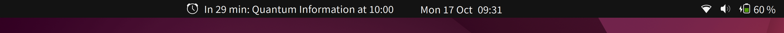
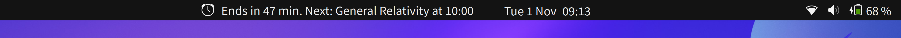
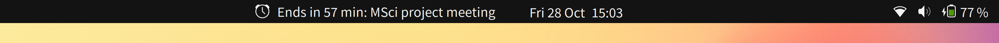
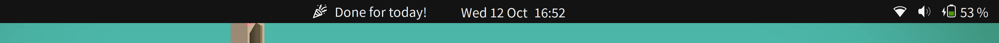
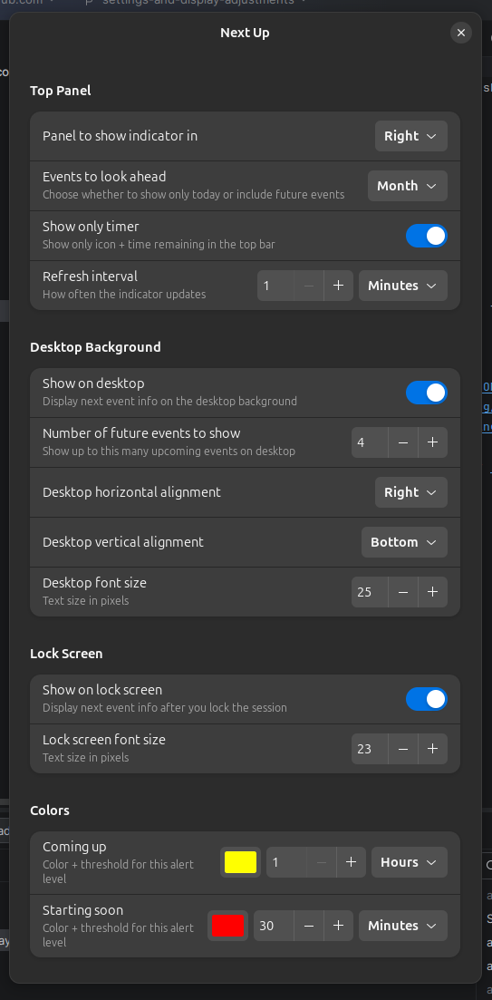

# Next Up
A GNOME Shell extension that shows your next calendar event in the status bar.

## Settings

## Compatibility

Supports GNOME Shell `45` to `49`.

## Features
- Top bar calendar status with upcoming/current event text.
- Icon states: Confetti when no events, Calendar by default, Alarm when "starting soon" threshold is reached.
- Configurable lookahead: `Today`, `Week`, `Month`.
- Optional top bar `Show only timer` mode (`In ...` / `Ends in ...`).
- Configurable refresh interval: `1-60` with units `Seconds` or `Minutes`.
- Configurable status colors + thresholds for `Coming up` and `Starting soon`.
- Optional lock screen display with configurable font size.
- Optional desktop display with configurable font size, alignment, and number of events.

## Installation
You can install the extension from [the extensions.gnome.org page](https://extensions.gnome.org/extension/5465/next-up/) by clicking the switch icon.

## Latest changelog
- Full changelog is in [CHANGELOG.md](./CHANGELOG.md).
- Added color pickers and threshold settings for status highlighting.
- Added top bar `Show only timer` mode.
- Improved time text: compact for top bar, detailed (`days, hours, minutes`) for lock screen/desktop.
- Updated event icon logic: calendar normally, alarm only when `starting soon` threshold is reached.

## References
- https://gitlab.gnome.org/GNOME/gnome-shell/-/blob/main/js/ui/calendar.js
- https://extensions.gnome.org/extension/4448/next-meeting/
- https://github.com/corecoding/Vitals

- [Party popper icon](https://www.flaticon.com/free-icon/party-popper_6335608) by [Ayub Irawan](https://www.flaticon.com/authors/ayub-irawan)
